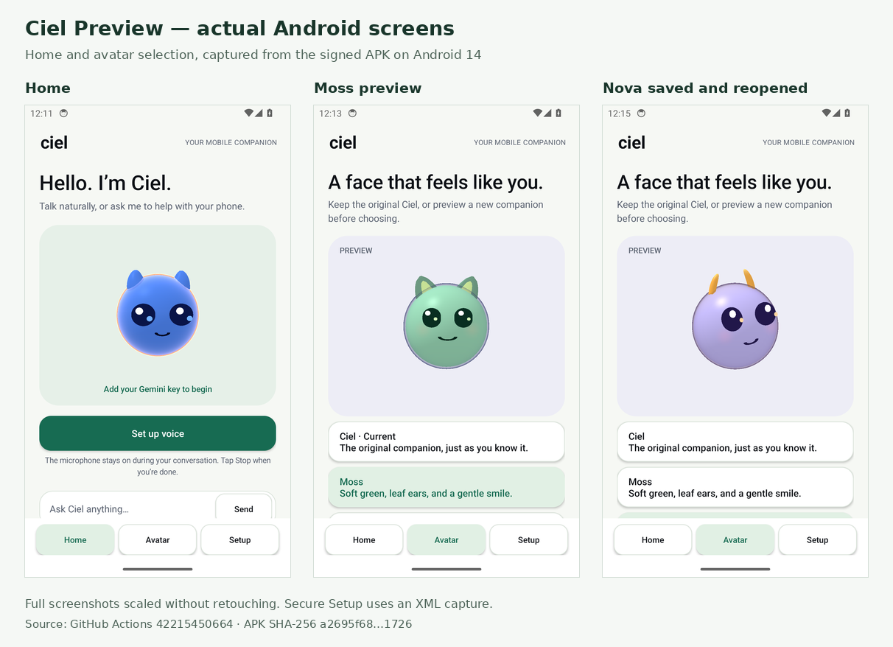
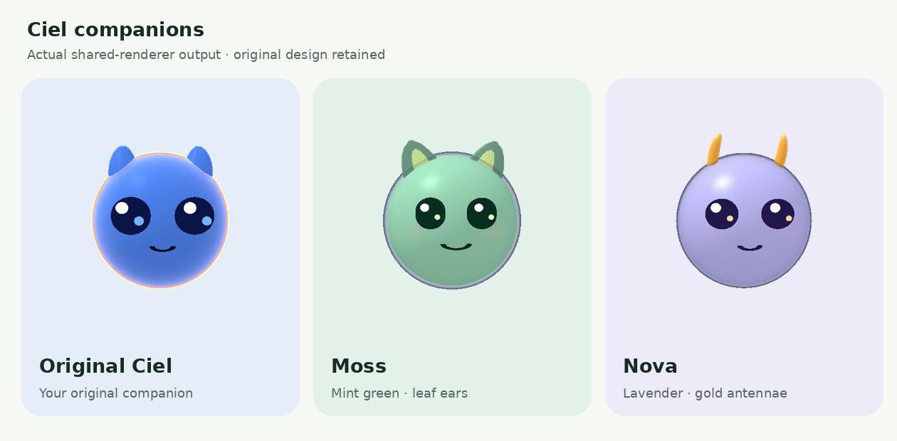

# Ciel mobile upgrade — evidence ledger

Requested on 2026-11-06. The application from `549ba53` has passed source checks, signing and independent package review. Scoped installation/UI checks passed across two Android 14 runs of the identical signed r2 APK. The first full r2 run passed seven checks and failed two harness assertions; a targeted rerun passed all five of its checks after changing how blank-key rejection and a wide viewport are verified. Actual screenshots confirm that the shorter Avatar label resolves the large-font navigation wrap. Successful Gemini voice and physical-phone actions remain unverified; this is a Preview, not a claim that every feature or phone is certified.

[Download Ciel Preview 0.12.0](https://github.com/Naruto859/ciel-ai-companion/releases/download/ciel-preview-v0.12.0-24/ciel-preview-0.12.0-24-r2-universal.apk) · [Install and setup](../../CIEL_MOBILE.md) · [Runtime evidence](evidence/runtime-r2/runtime-summary.json)

## Target and user intent

- Source: `/root/ciel-companion-clean`, fork of <https://github.com/kuafuai/andee>.
- Starting source commit: `e98627d`; working branch: `codex/ciel-mobile-upgrade-20261106`.
- Upstream inspected: `5e63543` (2026-11-05).
- Existing distributed APK: <https://cielmanu.indevs.in/dl/ciel-arm64.apk>.
- Existing APK SHA-256: `9167cff45b0c3cfc27fc73e0e61d92f5fc8bd519418d2af1cc7811d1aa454a7c`.
- Package `ai.ciel.companion`, version `0.11.0` (23), arm64, Android 11 minimum; distributed artifact is debuggable.
- Improve the actual mobile application: reliable authorized phone tools, direct Gemini Live conversation, understandable setup and home UI, retain the first/default avatar and replace the other selectable designs.
- User mentioned “Cloudflare” and a provider starting with “V”. The source has CodeFlying and Huoshan/Volcengine defaults; direct Gemini should not require them. Cloudflare also fronts the existing download domain; this is a separate infrastructure concern.
- Elysia exists at `/root/work/elysia`. Whether this is the user's “Aliza” reference is awaiting optional clarification.
- Phone model/Android version requested; no physical ADB device was connected at initial inspection.

## Scope and ownership

| Workstream | Owner | Current scope |
| --- | --- | --- |
| Voice | `voice_gemini` | Gemini Live protocol/audio, config, BodyCoreService wiring, focused tests |
| UI and avatars | `ui_avatars` | Native home, setup, avatar studio, shared ball renderer, UI/resources |
| Phone controls | `phone_controls` | Tool dispatch, cancellation, device/screen behavior, command transport admission |
| Integration and release | root | Source/APK comparison, skills/research, build/test setup, package verification, runtime exercise and documentation |

Parallel scopes follow the REA skill's broad-investigation workflow. Existing changes in `/root/workspace-andee` are outside the target and are preserved.

## Concrete findings and fixes

| Finding | Evidence | Status |
| --- | --- | --- |
| Default provider requires unavailable CodeFlying/Volcengine credentials | VoiceConfig defaults and provider routing | Direct Gemini setup with an owner-provided key |
| Existing Gemini flow is sequential ASR, model, TTS | Existing GoogleAsr, LlmClient, GoogleTts paths | Persistent Live audio, transcripts, interruption and tool session |
| Local command server exposes device operations without authentication | BodyWsServer; upstream PR 38 also identifies this | Off by default; loopback, per-install token and browser-origin rejection |
| Stop leaves queued actions and long waits running | Dispatcher/wait paths | Cancellation generations and final action checkpoints |
| Remote transport can invoke private local tools | Advertised schemas vs dispatch enforcement | Enforced dispatcher admission and reserved extension names |
| Extension responses lack ownership or arrive before the waiter | Extension-response handling | Connection ownership and bounded buffering |
| Uncertain keyboard writes can type twice | Accessibility IME fallback | Distinguish unavailable input from an already-submitted write |
| Permissions and device tools can misreport success | Combined grants, location, calendar, SMS/call/alarm paths | Accurate grants, approximate location, cleanup and truthful submission results |
| No durable launcher home; controls depend on overlay gestures | Launcher manifest and SelfCheckActivity | Native Home / Avatar / Setup with visible Talk and Stop |
| Small controls, stale avatar selection and shared preview state | Theme/expression/GL preview code | Larger controls, contrast changes and preview-before-save isolation |
| Transparent renderer produces bright color bands | Actual Nova output and pixel inspection | Separate alpha blending in both backends; 57 final frames have zero invalid-alpha pixels |
| Published artifact is debuggable and uses an unavailable signing key | Existing APK metadata | Signed nondebuggable Ciel Preview with a separate package and signing identity |

## Research and verification

- Hermes `find-skills` and Firecrawl were found and read; Firecrawl access works.
- REA `reverse-engineer-anything` was read; installed CLI is 6.7.0. Two APK/JADX provider startups hit deadlines. No successful decompilation is claimed; source, Android SDK package inspection and actual renderer output provide the available evidence.
- Current official Gemini documentation was researched through Firecrawl. Do not substitute remembered model names for these current sources.
- Authoritative builds use JDK 17 and two bounded Gradle workers in CI. Local SDK `/opt/android-sdk` supplies release signing and package checks.
- Existing tests are the baseline; meaningful new tests target protocol, cancellation, security admission and user-visible state transitions.
- No claim of physical-device installation, microphone quality, real-world response latency, unrestricted phone control, unlimited free API usage, or exhaustive absence of bugs is made from static analysis.
- Actual original, Moss and Nova portraits and all 19 expression frames per character were inspected. The final build's compiled core classes match the rendered core byte-for-byte.

## Completion checklist

- [x] Complete the scoped concrete fixes and cross-workstream integration; independent source review found no remaining P0/P1 findings in the reviewed paths.
- [x] Verify source tests and release build/lint.
- [x] Inspect actual new avatar output.
- [x] Inspect actual Android Home, avatar, large-font and wide-viewport output.
- [x] Exercise fresh install, resumed startup, blank-key setup rejection, avatar preview/save/restart and navigation on Android 14.
- [x] Verify Gemini Live protocol tests and perform a bounded server probe; the available key was rejected before setup, so a successful session is still blocked.
- [x] Verify final APK identity, ABIs, signature, notices and bounded credential exclusion.
- [x] Verify exact APK installation and the scoped UI runtime checks, with both runs' installed hashes matching r2.
- [x] Independent review of current source and final artifact.
- [x] Document exact remaining limitations and prepare source, screenshots and the signed installable Preview.

**Still blocked or unverified:** real Gemini audio, Talk/Stop during a live session, permission-denial/retry flows, physical-phone actions and latency. These require a new valid key and/or a target phone. Native picked-document reading remains missing; background reviews/planning remain Custom-model features.

## Exact build and validation

Final application source: `549ba53619e3d78ce0f3887dd291f10e5400033a`. The signed r2 APK differs from the first candidate in its navigation resources, VCS metadata and signing metadata; executable DEX, manifest and native libraries are identical. Later validation/report changes do not alter the packaged production files.

| Gate | Evidence | Result |
| --- | --- | --- |
| Core/Android unit suites | [CI 42213575554](https://github.com/Naruto859/ciel-ai-companion/actions/runs/42213575554), [counts](evidence/ci-42213575554-source.json) | **423 passed:** 328 core + 95 Android; zero skipped/failures/errors |
| Release lint/build | Same source job; canonical and Preview release builds, desktop Kotlin compilation | **Passed:** 0 lint errors, 513 warnings (mainly KTX and unused-resource advisories). Desktop runtime untested. |
| Avatar renderer | [Frames and hashes](evidence/renderer-validation.json) | **57/57 passed**, zero invalid-alpha pixels |
| Signed r2 APK | [Package verification](evidence/final-apk.json), `apksigner`, ZIP alignment, manifest/ELF/ZIP inspection | **Passed:** nondebuggable, ARM64, signature, alignment, notices and credential-pattern checks |
| Independent review | [Final artifact review](final-artifact-review.md), [evidence](evidence/final-artifact-review.json) | No concrete P0/P1 blocker in reviewed source/package; all 368 frozen source hashes match |
| First-candidate Android install/UI runtime | [CI 42211532681](https://github.com/Naruto859/ciel-ai-companion/actions/runs/42211532681), [evidence](evidence/runtime-before-ui-fix/runtime-summary.json) | Exact bytes installed and launched; original/Moss/Nova preview/save/restart passed; no app crash/ANR. Full check set failed on secure screenshots and emulator rotation. |
| Exact r2 full Android install/UI run | [CI 42215450664](https://github.com/Naruto859/ciel-ai-companion/actions/runs/42215450664), [raw report](evidence/runtime-r2/full/smoke-report.json) | **7/9 passed:** exact installation, launch, original/Moss/Nova flows, large-font tabs and no app crash/ANR. Overall run failed on inline-error discovery and rotation. |
| Exact r2 targeted setup/layout run | [CI 42217850551](https://github.com/Naruto859/ciel-ai-companion/actions/runs/42217850551), [raw report](evidence/runtime-r2/setup-layout/smoke-report.json) | **5/5 passed:** fresh exact-byte install, launch, persistent blank-key rejection, 1920×1080 viewport tabs and no app crash/ANR. |
| Live protocol fixture | [Compiled setup](research/live-setup-validation.json), [provenance](research/live-setup-validation-provenance.json) | **90 declarations** match the final compiled built-in Live filter |
| Real Gemini conversation | [Google probe](evidence/gemini-live-server-direct.json) | **Blocked:** rejected key before `setupComplete` |
| Physical phone, audio quality and action latency | No target phone connected | **Unverified** |

The initial runtime job stopped before installation because its verifier expected an older `apksigner` certificate label. Build Tools 37 reports `V3.0 Signer:`; the exact public report is now a regression fixture. A staging attempt also could not read the private draft with a read-only token. Draft access is now isolated in a download-only job with no checkout or application execution. Those failed attempts do not count as runtime passes.

The [combined r2 runtime summary](evidence/runtime-r2/runtime-summary.json) retains the failed full-run assertions. The targeted harness checks that empty Save leaves Setup active and that Home still requests a key after restart; it does not claim to have read Android's inline error caption. It creates a genuinely wide viewport with `wm size` and checks actual PNG dimensions and navigation bounds. Physical rotation/sensors remain untested. No single successful rerun of the full suite is claimed. Secure Setup pages have XML evidence only. The wide layout is scrollable; not every hero/control is visible at once.

Both local software-only emulators failed to reach online ADB on this loaded VPS and were stopped; no unrelated services were stopped. [Local emulator evidence](evidence/local-emulator-api31.json).

## Preview identity and companions

The signed artifact is `ciel-preview-0.12.0-24-r2-universal.apk`, version 0.12.0 (24), Android 11+, with ARM64 included. **Ciel Preview** uses `ai.ciel.companion.preview`; it installs alongside old Ciel with separate settings/history. The independent review confirms distinct provider authorities/signature permissions, no shared UID or required split flags, and exact unsigned-to-signed payload equality. The earlier candidate was not published.

- APK SHA-256: `a2695f68f8151d4c44680e8b6d980a4ab9d96241c39ec185267c63c6d2211726`.
- Certificate SHA-256: `1e11584f8c081fc18f0ddaf6467a8268f59bf5a37c2b0bd55105bb7af0a17bac`.
- Original design parameters remain byte-for-byte identical: `ef13f7926f4a58e791c3a41f99f2d6c1f2d13c439e0180adfeec795826a47926`.

These are unretouched Android screenshots scaled into a contact sheet. [Original captures](previews/android), [large-font Home](previews/android/large-font-home.png), and [landscape viewport](evidence/runtime-r2/setup-layout/landscape-home.png) retain the full images. The Setup credential window deliberately blocks screenshots.

[Original expressions](previews/andee-expressions.png) · [Moss expressions](previews/moss-expressions.png) · [Nova expressions](previews/nova-expressions.png)

These are actual renderer snapshots, not concept art or proof of microphone-driven animation. Signing material remains outside the repository and CI. Default identity is Ciel; explicitly chosen owner names/personas are preserved.

## Remaining boundaries

- A new valid Gemini key is needed for real conversation/tool testing. Hermes and Elysia held the same rejected key. Enter a new key in **Setup**, or provide its protected file path for a bounded probe. No end-to-end latency measurement exists; 20 ms audio chunks and 350 ms VAD silence are configuration values.
- Android permissions, protected screens, locks and OEM restrictions constrain phone control. Gestures already handed to Android may finish after Stop. SMS/call/alarm submission does not establish delivery or completion.
- Automatic notification rules, nightly reviews, background planning and topic folding remain explicitly **Custom model** features. Manual Live conversation and supported phone/notebook tools are connected.
- Native user-picked document reading remains missing; this pass does not close upstream [issue 37](https://github.com/kuafuai/andee/issues/37) or establish that every upstream issue is fixed.
- The new companions support the existing 19 moods and motion engine, not every possible emoji or human emotion.
- Google controls free-tier quotas, regions and model availability; unlimited free service cannot be guaranteed.
- The normal Android Live route needs neither CodeFlying nor Huoshan/Volcengine and does not use Cloudflare. Global DNS and the old Cloudflare-fronted download site were not changed.
- Elysia may be the user's “Aliza” reference; this remains unconfirmed. No Elysia deployment was changed.

See [CIEL_MOBILE.md](../../CIEL_MOBILE.md), [voice audit](voice-integration.md), [phone-control audit](../phone-control-audit-20261106.md), [UI notes](ui-avatar-notes.md) and [source review](independent-review.md).
